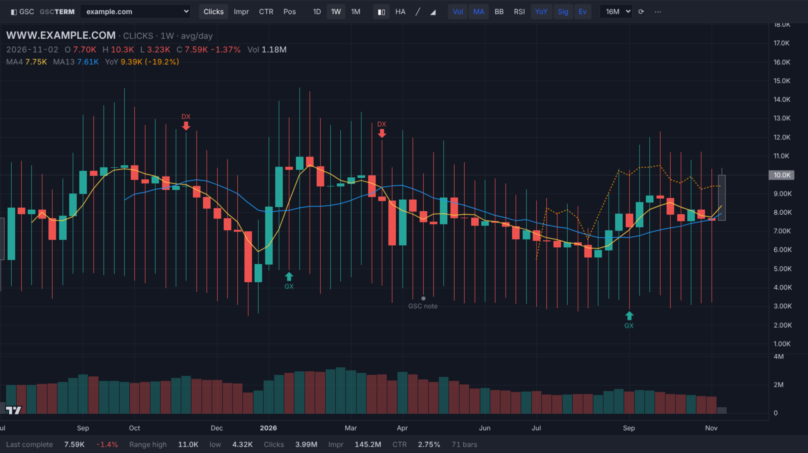
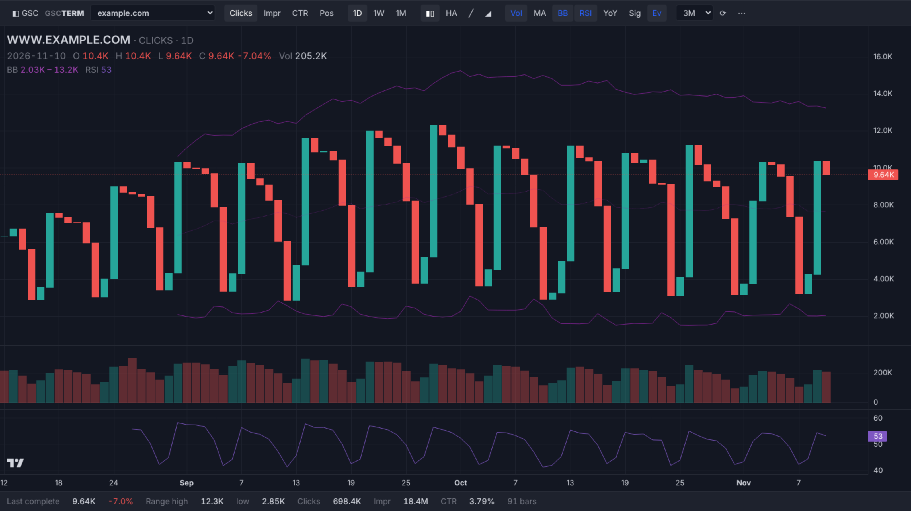
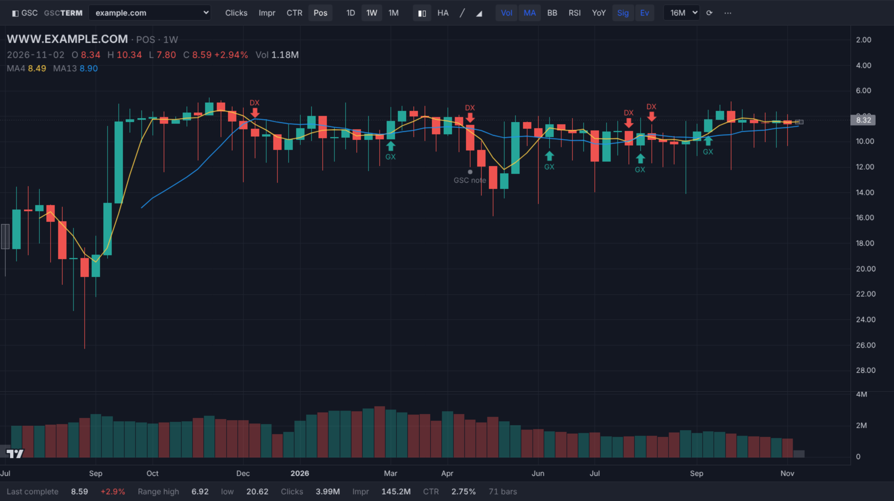
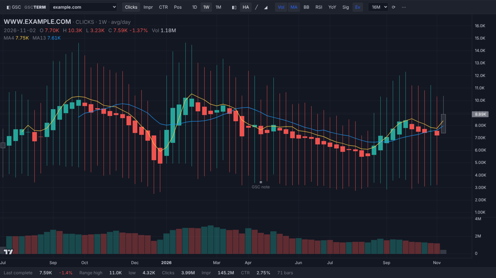
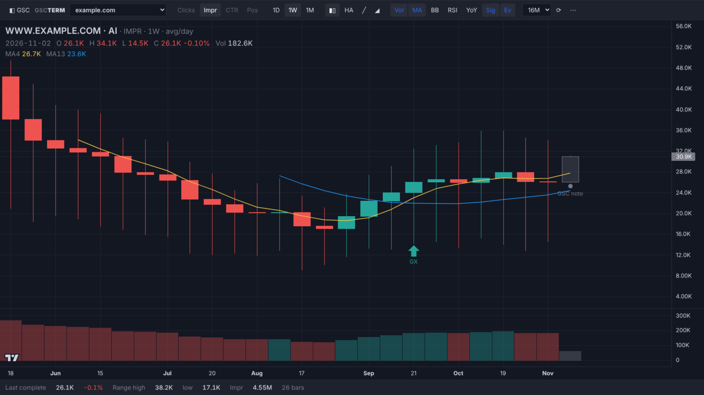

# GSC Terminal

Google Search Console performance reports as TradingView-style candlestick charts. A Chrome extension that takes over the Search Console performance page and shows the same property, report and filters with candles, moving averages, Bollinger Bands, RSI, a YoY overlay and event markers.

Built after John Mueller asked: *"Is there a Search Console → Trading View adapter?"* Write-up: [notprovided.eu]([https://www.notprovided.eu/](https://www.notprovided.eu/gsc-terminal-read-search-console-like-a-trading-chart/)).

## Features

- **Takes over Search Console performance reports**: Search results, Discover, News and the Generative AI report.
- **Same view, longer history**: picks up the property, report, search type and every filter set in Search Console, then loads up to 16 months of daily data.
- **Chart types**: candles, Heikin Ashi, line and area on 1D, 1W and 1M bars.
- **Metrics**: clicks, impressions, CTR and position (inverted scale, so up always means better).
- **Indicators**: moving averages with GX/DX crossover signals, Bollinger Bands (20, 2), RSI (14), volume pane, year-over-year overlay.
- **Events**: double-click a bar to add a marker; Search Console's own annotations show as "GSC note".
- **No OAuth, no API quota**: uses your logged-in Search Console session, including every `/u/N/` account.
- **CSV export** of the candles.

## Install

1. Download the latest zip from [Releases](../../releases) (or clone this repo).
2. Unzip it somewhere permanent.
3. Open `chrome://extensions` and switch on **Developer mode**.
4. Click **Load unpacked** and select the `extension` folder (the one with `manifest.json`).
5. Reload any open Search Console tabs.

## Usage

Open any Search Console performance report. About a second after Search Console draws its chart, the terminal takes over the page below the header.

| Control | What it does |
| --- | --- |
| ◧ GSC / Alt+T | Back to the native report, to change filters with Google's controls |
| 📈 Terminal (bottom right) | Return to the terminal; it reloads with the new filters |
| Clicks / Impr / CTR / Pos | Metric. Keys `c` `i` `r` `p` |
| 1D / 1W / 1M | Bar size. Keys `1` `2` `3` |
| Candles / HA / line / area | Chart type |
| Vol, MA, BB, RSI, YoY, Sig, Ev | Toggle indicators, signals and events |
| 3M / 6M / 12M / 16M | History loaded |
| ⋯ | Export CSV, manage events, demo data |

### How the candles are built

| Part | Meaning |
| --- | --- |
| Close | Value for the bar. On 1W and 1M, clicks and impressions are averages per day; CTR is clicks / impressions; position is impression-weighted |
| Open | Previous bar's close, so the body is the period-over-period change |
| High / low | Best and worst single day in the bar |
| Volume | Total impressions (total clicks when charting impressions) |
| Grey bar | Incomplete period, or data Google marks as incomplete |

| | |
| --- | --- |
|  |  |
|  |  |

## How it works

- `extension/gsc-bridge.js` runs in the Search Console page. It watches the page's own data requests to learn the current report and filters, then replays that request with a longer date range in your session. Nothing leaves your browser.
- `extension/content.js` overlays the terminal (an extension iframe) on performance pages. Search Console enforces Trusted Types, so the UI lives in its own document.
- `extension/chart.js` + `extension/lib/indicators.js` build the candles and indicators and render them with [TradingView Lightweight Charts](https://github.com/tradingview/lightweight-charts).

**Caveat:** this relies on Search Console's internal, undocumented data format. If Google changes it, the terminal shows an error and the native report keeps working. Optional API mode (own OAuth client, standalone tab) is described in [extension/README.md](extension/README.md).

## License

MIT, see [LICENSE](LICENSE). TradingView Lightweight Charts is Apache 2.0.
